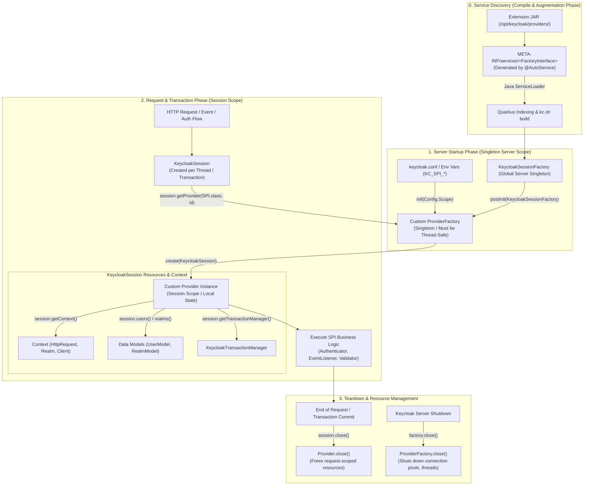
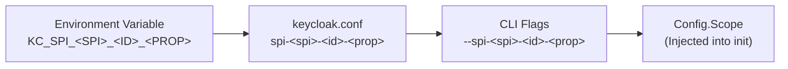

# Keycloak Extensions Architecture & SPI Guide

## 1. The Keycloak SPI Model in Quarkus

Since Keycloak 18+, Keycloak runs on **Quarkus** rather than the legacy WildFly application server. This brings significant performance improvements, faster startup times, and ahead-of-time (AOT) optimizations during `kc.sh build`.

Keycloak extensions are built using Java's standard `ServiceLoader` mechanism, extended by Keycloak's component architecture into a **dual-lifecycle model** (Server-Scope Singleton vs. Request-Scope Session).

---

## 2. Complete SPI Lifecycle & Component Architecture



---

## 3. Core Architectural Abstractions

Keycloak strictly decouples server-wide coordination from request-level execution:

### 3.1. `ProviderFactory<P extends Provider>` (Server-Scope Singleton)
* **Lifecycle:** Instantiated **once** when Keycloak boots. Retained in memory by `KeycloakSessionFactory` until server shutdown.
* **Thread-Safety:** **Critical.** The factory is accessed concurrently by all worker threads. It must be stateless or strictly thread-safe.
* **Initialization Hooks:**
  * `init(Config.Scope config)`: Reads SPI configuration parameters from `keycloak.conf`, CLI flags, or environment variables (`KC_SPI_*`).
  * `postInit(KeycloakSessionFactory factory)`: Configures cross-provider dependencies or registers system-wide event callbacks after all factories are loaded.
  * `getId()`: Declares the unique provider identifier registered in Keycloak realms and execution flows.
* **Resource Ownership:** Manages heavy, reusable resources (e.g., native `HttpClient`, shared LRU caches, connection pools).

### 3.2. `Provider` (Request/Session Scope)
* **Lifecycle:** Created on-demand per request or transaction by `factory.create(KeycloakSession session)`.
* **Statefulness:** Bound to the lifetime of the handling thread/transaction. It can maintain local state for that specific request.
* **Integration Hub (`KeycloakSession`):** Receives the active `KeycloakSession` to query users, realms, credentials, active HTTP request headers, and transaction boundaries.
* **Cleanup (`close()`):** Keycloak automatically invokes `provider.close()` when the session ends. Must release any local memory or request-bound handles.

---

## 4. Discovery & Registration (`@AutoService`)

Keycloak discovers extensions via standard Java `ServiceLoader` manifests located in `META-INF/services/`.

To eliminate manual descriptor errors, all providers in this repository use Google `@AutoService`:

```java
@AutoService(EventListenerProviderFactory.class)
public class WebhookEventListenerProviderFactory implements EventListenerProviderFactory {
    @Override
    public String getId() {
        return "webhook";
    }
    // ...
}
```

During annotation processing (`javac`), `@AutoService` automatically outputs:
`META-INF/services/org.keycloak.events.EventListenerProviderFactory` containing the fully qualified class name.

---

## 5. Configuration Architecture (`Config.Scope`)

Keycloak injects configuration into `ProviderFactory.init(Config.Scope)` following a standard hierarchical precedence:



Example for the Webhook Event Listener:
* **Environment Variable:** `KC_SPI_EVENT_LISTENER_WEBHOOK_ENDPOINT_URL=https://events.example.com`
* **Configuration File (`keycloak.conf`):** `spi-event-listener-webhook-endpoint-url=https://events.example.com`

---

## 6. Resilience & Concurrency Guidelines

Because Keycloak handles critical identity, authentication, and token issuance transactions, extensions must adhere to strict enterprise reliability standards:

1. **Non-blocking Execution:** Event listeners execute synchronously inside event publishing threads. Outbound I/O must use asynchronous dispatch (`sendAsync`) with strict timeouts or fire-and-forget queues.
2. **Transaction Isolation & Fail-Open / Fail-Closed Design:**
   * **Auditing SPIs (Event Listeners):** Must operate in **fail-open** mode. Unreachable external endpoints or network glitches must never roll back user authentication or block logins.
   * **Security Policies (Authenticators / Validators):** Must define explicit failure modes (e.g., fail-open with security audit logging when a verification API is degraded, or fail-closed if required by NIST / PCI-DSS compliance).
3. **Native HTTP Client:** Use Java 21's `java.net.http.HttpClient` with non-blocking async dispatch (`CompletableFuture`) and explicit connect/read timeouts. Avoid heavyweight third-party HTTP libraries that cause classloader collisions with Quarkus.

