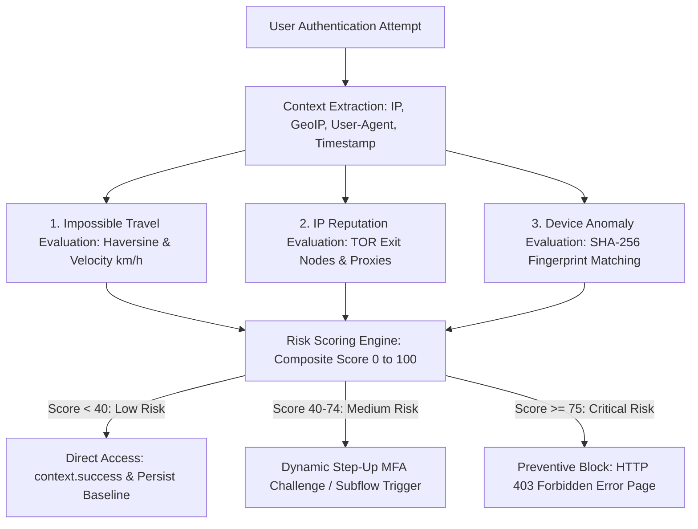

# Keycloak Extension: Zero-Trust Adaptive Risk Evaluator

A high-performance, contextual risk evaluation Authenticator SPI for **Keycloak 26.x Quarkus runtime**.
Enforces **Zero-Trust Continuous Adaptive Risk Assessment (CARTA)** by dynamically evaluating impossible travel velocity, IP reputation (TOR exit nodes & anonymous proxies), and device fingerprint changes to trigger automated Step-Up MFA challenges or preventive blocks.

---

## 1. Architectural Overview & Workflow



### Risk Evaluation Components
1. **Impossible Travel Velocity:**
   * Uses the **Haversine great-circle formula** to calculate distance in kilometers between the user's last verified login coordinates and current coordinates.
   * Derives speed: $v = \frac{\Delta\text{distance (km)}}{\Delta\text{time (hours)}}$.
   * If speed exceeds commercial flight thresholds (default: $900\text{ km/h}$), assigns an immediate $+50$ risk penalty.
2. **IP Reputation & Network Anonymity:**
   * Fast in-memory lookup matching against curated public TOR exit nodes.
   * Automatic exemption and clean rating for private IPv4/IPv6 networks (`127.0.0.1`, `10.0.0.0/8`, `172.16.0.0/12`, `192.168.0.0/16`).
   * Assigns $+50$ risk penalty if originating from an anonymous node.
3. **Device Fingerprint Anomaly:**
   * Computes a deterministic SHA-256 fingerprint hash combining `User-Agent`, `Accept-Language`, and client `/24` subnet.
   * Compares against verified historical fingerprints on the user model (`known_device_fingerprints`).
   * Assigns $+15$ risk penalty if logging in from an unrecognised device.
4. **Baseline for First-Time Logins:**
   * Assigns a controlled baseline penalty ($+10$ points) on initial login without historical data, ensuring fail-open resilience without blocking legitimate new users.

---

## 2. Configuration Reference

Configuration parameters can be defined at global server startup via environment variables or inside the Keycloak Admin Console (Authentication -> Flow Executions -> Config):

| Parameter | Environment Variable | Default | Description |
| :--- | :--- | :--- | :--- |
| **`max-velocity-kmh`** | `KC_SPI_AUTHENTICATOR_RISK_MAX_VELOCITY` | `900` | Maximum acceptable travel speed in km/h between logins. |
| **`step-up-threshold`** | `KC_SPI_AUTHENTICATOR_RISK_STEPUP_THRESHOLD` | `40` | Risk score threshold to trigger Step-Up MFA challenge. |
| **`block-threshold`** | `KC_SPI_AUTHENTICATOR_RISK_BLOCK_THRESHOLD` | `75` | Risk score threshold to preventively block access. |
| **`block-tor-nodes`** | `KC_SPI_AUTHENTICATOR_RISK_BLOCK_TOR` | `true` | Penalize logins originating from verified TOR exit nodes. |

---

## 3. Session Notes & Flow Integration

The evaluator writes contextual session notes available to downstream Keycloak authenticators, conditional subflows, and Protocol Mappers:

| Note Key | Values | Scope | Description |
| :--- | :--- | :--- | :--- |
| `adaptive_risk_score` | `0` - `100` | Auth & User Session | Normalized numeric risk score. |
| `adaptive_risk_level` | `LOW`, `MEDIUM`, `CRITICAL` | Auth & User Session | Qualitative risk classification. |
| `adaptive_risk_step_up` | `true` / `false` | Auth & User Session | Flag indicating MFA step-up requirement. |
| `adaptive_risk_blocked` | `true` / `false` | Auth Session | Flag indicating access denial. |

---

## 4. Keycloak Installation & Deployment

1. Build or download `keycloak-authenticator-adaptive-risk-1.0.0-SNAPSHOT.jar`.
2. Copy the JAR into Keycloak's providers directory:
   ```bash
   cp keycloak-authenticator-adaptive-risk-1.0.0-SNAPSHOT.jar /opt/keycloak/providers/
   ```
3. Re-build Keycloak Quarkus container:
   ```bash
   /opt/keycloak/bin/kc.sh build
   ```
4. Start Keycloak:
   ```bash
   /opt/keycloak/bin/kc.sh start --optimized
   ```
5. In Keycloak Admin Console:
   * Navigate to **Authentication** -> **Browser Flow**.
   * Add execution **Zero-Trust Adaptive Risk Evaluator** after the Username/Password validation step.
   * Set requirement to **REQUIRED** (or inside a **CONDITIONAL** subflow paired with Conditional OTP Form).
