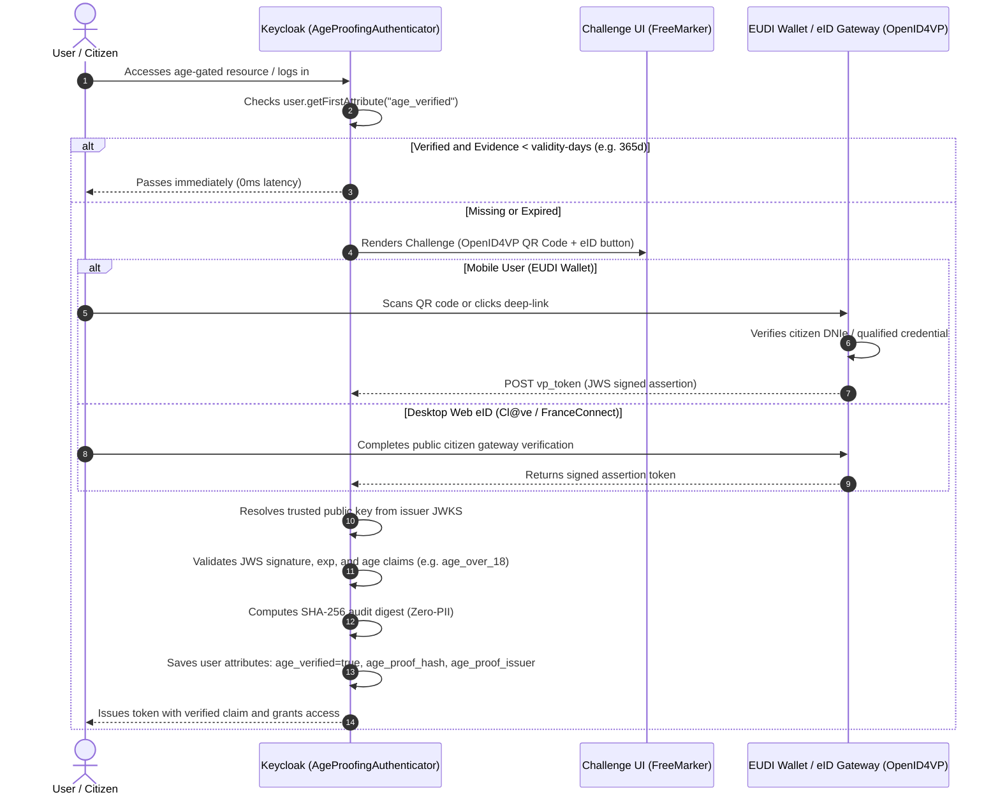

# Age & Identity Proofing SPI for Keycloak 26.x (eIDAS 2.0 / OpenID4VP)

Enterprise-grade, privacy-preserving Age &amp; Identity Proofing extension for Keycloak 26.x on Quarkus. Integrates Keycloak with EU Digital Identity Wallets (**EUDI Wallet** / **OpenID4VP**) and public eID gateways (**Cl@ve**, **FranceConnect**, **SPID**, **BankID**) to cryptographically verify legal age with **Zero Personal Identifiable Information (Zero-PII)** storage in accordance with **GDPR (Articles 5 and 25)** and EU Digital Services Act regulations.

---

## 🛡️ Key Features & Architectural Highlights

* **Zero-PII Privacy by Design (GDPR Art. 5 & 25):**
  * Does **never** store user real names, national identity document numbers, or exact birthdates.
  * Only an immutable SHA-256 cryptographic digest of the government assertion (`age_proof_hash`), the trusted authority URI (`age_proof_issuer`), and verification timestamp (`age_verified_at`) are retained for compliance auditability.
* **Dual SPI Implementation:**
  1. **`Authenticator` (`age-identity-proofing`):** Executed as a step in Keycloak authentication flows (e.g. conditional step-up authentication when accessing restricted OAuth2 scopes or client resources).
  2. **`RequiredActionProvider` (`age-verification-action`):** Executed post-authentication as an onboarding or periodic account compliance action.
* **Hybrid User Interaction Mode:**
  * Displays a responsive, accessible FreeMarker interface with an **OpenID4VP QR code** for mobile digital wallets (EUDI Wallet) alongside a direct redirect button for desktop **public eID gateways** (Cl@ve, FranceConnect).
* **Native Cryptographic Engine:**
  * Validates JSON Web Signatures (JWS) supporting `RS256`, `RS384`, `RS512`, `ES256`, `ES384`, and `ES512` using Keycloak's built-in Jose libraries and Java 21 native cryptography with zero external dependencies.
* **Resilient JWKS Cache:**
  * Fetches and caches JSON Web Key Sets (JWKS) in-memory with configurable TTL and bounded timeouts (3s connect, 5s read) using native Java 21 `HttpClient`.
* **Configurable Fail-Close / Fail-Open:**
  * Strict fail-close enforcement by default for legal compliance, with optional fail-open capability for development and staging environments.

---

## 🔄 Cryptographic Flow Diagram



---

## ⚙️ Configuration Reference

All properties can be configured at the realm execution level or globally via SPI environment variables:

| Parameter | Environment Variable | Type | Default | Description |
| :--- | :--- | :--- | :--- | :--- |
| `min-age` | `KC_SPI_AUTHENTICATOR_AGE_PROOFING_MIN_AGE` | Integer | `18` | Minimum legal age required for access. |
| `jwks-url` | `KC_SPI_AUTHENTICATOR_AGE_PROOFING_JWKS_URL` | String | - | URL to the public JSON Web Key Set of the trusted identity gateway. |
| `validity-days` | `KC_SPI_AUTHENTICATOR_AGE_PROOFING_VALIDITY_DAYS` | Integer | `365` | Number of days before the user must re-verify their age. |
| `allowed-issuers` | `KC_SPI_AUTHENTICATOR_AGE_PROOFING_ALLOWED_ISSUERS` | String | - | Comma-separated list of trusted issuer identifiers (leave blank to allow all valid under JWKS). |
| `mode` | `KC_SPI_AUTHENTICATOR_AGE_PROOFING_MODE` | String | `hybrid` | Interaction mode: `hybrid` (QR + eID button), `qr-wallet` (OpenID4VP only), or `redirect` (eID only). |
| `fail-open` | `KC_SPI_AUTHENTICATOR_AGE_PROOFING_FAIL_OPEN` | Boolean | `false` | Bypasses blocking if the external JWKS is unreachable (staging/testing only). |
| `eid-gateway-url` | `KC_SPI_AUTHENTICATOR_AGE_PROOFING_EID_GATEWAY_URL` | String | - | Web portal URL of the public eID service (e.g. `https://clave.gob.es`). |
| `api-timeout-ms` | `KC_SPI_AUTHENTICATOR_AGE_PROOFING_TIMEOUT_MS` | Integer | `3000` | HTTP connect and read timeout in milliseconds for resolving public JWKS. |
| `cache-ttl-minutes` | `KC_SPI_AUTHENTICATOR_AGE_PROOFING_CACHE_TTL_MINUTES` | Integer | `60` | In-memory cache duration for resolved JWKS public keys. |

---

## 📋 Zero-PII Audit Attributes

Upon successful cryptographic assertion verification, Keycloak stores strictly non-identifiable attributes on the `UserModel`:

```json
{
  "attributes": {
    "age_verified": ["true"],
    "age_verified_at": ["1776288000"],
    "age_proof_hash": ["e3b0c44298fc1c149afbf4c8996fb92427ae41e4649b934ca495991b7852b855"],
    "age_proof_issuer": ["https://clave.gob.es"]
  }
}
```

* **No Date of Birth (DoB)** is stored.
* **No National Identification Number** (DNI, NIE, SSN, Fiscal Code) is stored.
* **No Citizen Name** is stored.

---

## 🚀 Keycloak Installation & Setup

1. Copy the packaged JAR file into the Keycloak providers directory:
   ```bash
   cp keycloak-authenticator-age-identity-proofing-1.0.0-SNAPSHOT.jar /opt/keycloak/providers/
   ```
2. Re-build Keycloak Quarkus runtime:
   ```bash
   /opt/keycloak/bin/kc.sh build
   ```
3. Start Keycloak:
   ```bash
   /opt/keycloak/bin/kc.sh start --optimized
   ```
4. **Enable in Keycloak Admin Console:**
   * **As an Authenticator:** Navigate to **Authentication** > **Flows** > Select or duplicate your Browser/Step-Up flow > **Add execution** > Select **Age & Identity Proofing**.
   * **As a Required Action:** Navigate to **Authentication** > **Required Actions** > Register **Age & Identity Verification (eIDAS 2.0 / OpenID4VP)**.
