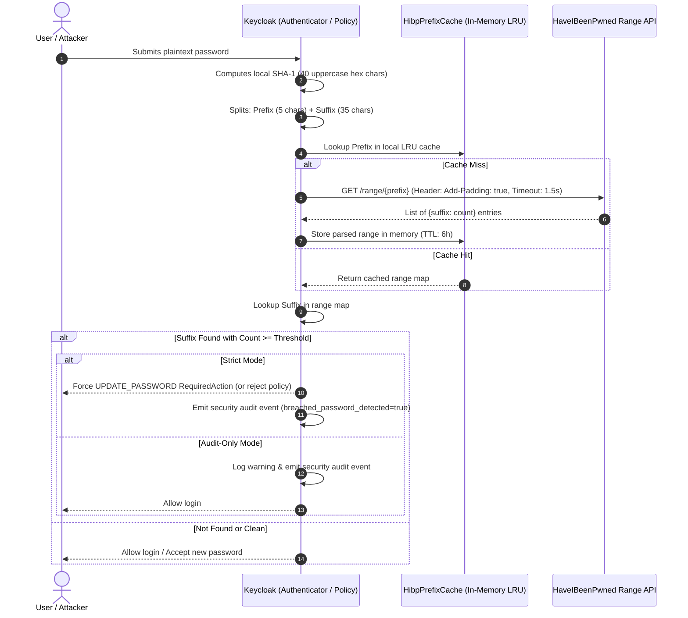

# Breached Password Detector SPI for Keycloak 26.x (HIBP k-Anonymity)

Enterprise-grade compromised credential detector for Keycloak 26.x on Quarkus. Validates passwords against billions of known data breaches in real-time using HaveIBeenPwned (HIBP) mathematical **k-Anonymity** to satisfy **NIST SP 800-63B**, **PCI-DSS v4.0 (Requirement 8.3.6)**, and **DORA** compliance.

---

## 🛡️ Key Features & Cryptographic Privacy

* **k-Anonymity Zero-Knowledge Privacy:**
  * Only the first 5 characters of the SHA-1 hash (`prefix`) leave Keycloak over TLS.
  * The remaining 35 characters (`suffix`) are matched in-memory against the returned range set. Plaintext passwords and full hashes are **never transmitted** over the network.
* **Side-Channel Protection:**
  * Transmits the `Add-Padding: true` HTTP header to prevent traffic analysis and response size inspection attacks.
* **Triple SPI Interception (360° Protection):**
  1. **`Authenticator` (`breached-password-authenticator`):** Evaluates existing passwords during standard login flows.
  2. **`PasswordPolicyProvider` (`breached-password-policy`):** Actively blocks users from selecting breached passwords during registration, reset credentials, and account profile changes.
  3. **`RequiredActionProvider` (`check-breached-password-action`):** Coordinates transparent forced password updates without disconnecting the user.
* **In-Memory Prefix Cache (LRU + TTL):**
  * Caches range query responses in memory (LRU with configurable TTL and capacity) to eliminate up to 80% of redundant external calls for common prefixes.
* **Fail-Open Resilience:**
  * Strict latency budget (1500 ms default). If HIBP is down or times out, fail-open mode prevents denial of service while logging a security audit event.

---

## 🔄 Cryptographic Flow Diagram



---

## ⚙️ Configuration Reference

All settings can be configured via Keycloak SPI configuration or environment variables:

| Parameter | Environment Variable | Type | Default | Description |
| :--- | :--- | :--- | :--- | :--- |
| `mode` | `KC_SPI_AUTHENTICATOR_BREACHED_PASSWORD_MODE` | String | `strict` | `strict` (forces immediate `UPDATE_PASSWORD`) or `audit-only` (logs security audit event only). |
| `breach-threshold` | `KC_SPI_AUTHENTICATOR_BREACHED_PASSWORD_THRESHOLD` | Integer | `1` | Minimum breach occurrences required to reject a password. |
| `api-timeout-ms` | `KC_SPI_AUTHENTICATOR_BREACHED_PASSWORD_TIMEOUT_MS` | Integer | `1500` | Maximum HTTP connect and read timeout in milliseconds. |
| `fail-open` | `KC_SPI_AUTHENTICATOR_BREACHED_PASSWORD_FAIL_OPEN` | Boolean | `true` | Allows authentication if HIBP is unreachable, preventing login denial of service. |
| `api-url` | `KC_SPI_AUTHENTICATOR_BREACHED_PASSWORD_API_URL` | String | `https://api.pwnedpasswords.com/range/` | Base URL for the HIBP range endpoint (configurable for private proxies or testing). |
| `cache-max-entries`| `KC_SPI_AUTHENTICATOR_BREACHED_PASSWORD_CACHE_MAX_ENTRIES` | Integer | `2048` | Maximum number of 5-character prefix responses held in memory. |
| `cache-ttl-minutes`| `KC_SPI_AUTHENTICATOR_BREACHED_PASSWORD_CACHE_TTL_MINUTES` | Integer | `360` | Expiration time for cached prefix entries in minutes (6 hours). |

---

## 📋 Security Audit Event Details

When a breached password is detected or when service degradation occurs, Keycloak populates the login event details:

### 1. Breached Password Detected
```json
{
  "type": "LOGIN",
  "realmId": "master",
  "userId": "c5d18b45-1234-4567-89ab-cdef01234567",
  "ipAddress": "192.168.1.100",
  "details": {
    "auth_method": "openid-connect",
    "breached_password_detected": "true",
    "breached_password_count": "3861493"
  }
}
```

### 2. Degraded Check (Fail-Open)
```json
{
  "type": "LOGIN",
  "realmId": "master",
  "userId": "c5d18b45-1234-4567-89ab-cdef01234567",
  "ipAddress": "192.168.1.100",
  "details": {
    "auth_method": "openid-connect",
    "breached_password_check": "degraded",
    "breached_password_reason": "hibp_unavailable"
  }
}
```

---

## 🚀 Installation & Verification

### 1. Build and Deploy
1. Compile the extension JAR:
   ```bash
   mvn clean package -pl extensions/authenticators/breached-password
   ```
2. Copy `keycloak-authenticator-breached-password-1.0.0-SNAPSHOT.jar` to `/opt/keycloak/providers/`.
3. Restart or rebuild Keycloak Quarkus:
   ```bash
   /opt/keycloak/bin/kc.sh build
   /opt/keycloak/bin/kc.sh start
   ```

### 2. Enable in Authentication Browser Flow
1. Navigate to **Authentication > Flows > Browser Flow**.
2. Click **Add execution** and select **Breached Password Detector**.
3. Set requirement to **Required** (or **Alternative**).
4. (Optional) Click the gear icon to customize threshold, mode, and timeout.

### 3. Enable in Realm Password Policy
1. Navigate to **Realm Settings > Authentication > Policies > Password Policy**.
2. Click **Add policy** and select **Reject Breached Passwords (HIBP)**.
3. Set the breach threshold (default: `1`).
4. Click **Save**. Any registration or password reset will now reject compromised passwords.
