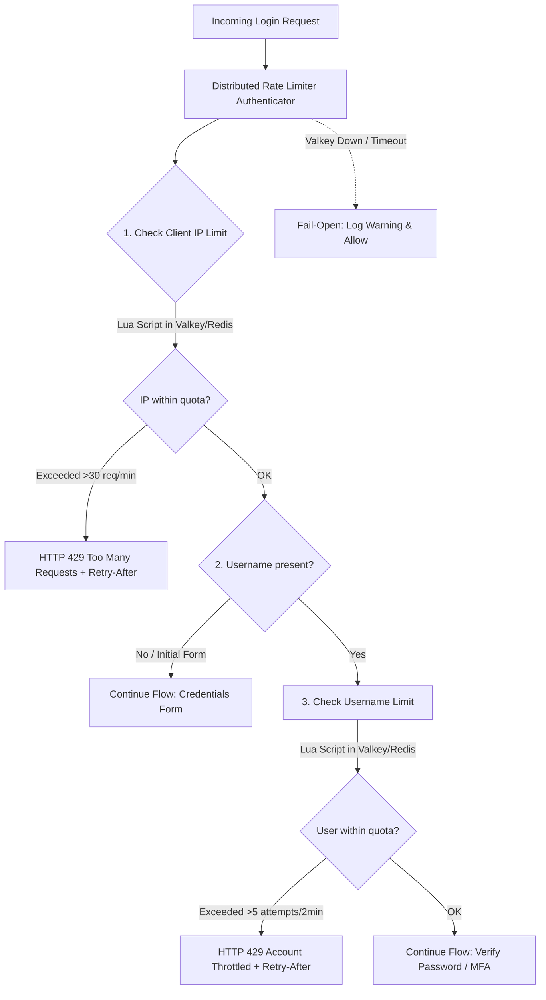

# Distributed Rate Limiter SPI for Keycloak 26.x (Valkey / Redis)

Enterprise-grade distributed sliding window rate limiter for **Keycloak 26.x** running on the modern **Quarkus** runtime. Protects multi-pod Kubernetes clusters against distributed credential stuffing and brute-force attacks in memory before touching relational databases.

---

## 🛡️ Key Features & Architecture

* **Dual-Layer Protection (IP + Username):**
  * **Perimeter IP Rate Limiting:** Enforced on all incoming requests at the beginning of authentication flows to block volumetric DDoS and high-frequency scanners.
  * **Account Credential Stuffing Limiting:** Enforced on targeted usernames/identities across distributed botnets and rotating proxies.
* **Atomic Sliding Window Algorithm:**
  * Uses Redis/Valkey `ZSET` structures with millisecond-precision timestamps.
  * Pruning, counting, adding, and TTL refresh are executed in a single atomic Lua script call to prevent race conditions across parallel Keycloak pods.
* **Valkey & Redis Native Compatibility:**
  * Powered by `io.valkey:valkey-java` (official Linux Foundation client).
  * 100% wire-compatible with Valkey 7.x/8.x and Redis 6.x/7.x.
  * Packaged using `maven-shade-plugin` with package relocation to guarantee zero classloader conflicts in Quarkus.
* **RFC-Compliant HTTP 429 & Retry-After:**
  * Returns standard HTTP `429 Too Many Requests` responses with `Retry-After`, `X-RateLimit-Limit`, `X-RateLimit-Remaining`, and `X-RateLimit-Reset` headers.
  * Renders localized Keycloak UI error pages for browser users, and JSON error payloads for OAuth2/OIDC REST and direct-grant clients.
* **Fail-Open Resilience:**
  * If the Valkey/Redis cache cluster undergoes failover, reboot, or connection timeout (>500ms), requests fail open with structured warning logs to avoid locking out legitimate users.

---

## 🔄 Architecture & Flow Diagram



---

## ⚙️ Configuration Reference

Parameters can be configured globally via environment variables / `keycloak.conf`, or overridden per execution in the Keycloak Admin Console:

| Parameter | Environment Variable | Admin Console Property | Type | Default | Description |
| :--- | :--- | :--- | :--- | :--- | :--- |
| **`redis-uri`** | `KC_SPI_AUTHENTICATOR_DISTRIBUTED_RATE_LIMITER_REDIS_URI` | `Valkey / Redis URI` | String | `valkey://localhost:6379` | Connection URI. Supports `valkey://`, `valkeys://`, `redis://`, and `rediss://`. |
| **`ip-limit`** | `KC_SPI_AUTHENTICATOR_DISTRIBUTED_RATE_LIMITER_IP_LIMIT` | `IP Rate Limit` | Integer | `30` | Maximum requests allowed per IP in the sliding window. |
| **`ip-window-seconds`** | `KC_SPI_AUTHENTICATOR_DISTRIBUTED_RATE_LIMITER_IP_WINDOW` | `IP Sliding Window (seconds)` | Integer | `60` | Duration of the IP window in seconds. |
| **`user-limit`** | `KC_SPI_AUTHENTICATOR_DISTRIBUTED_RATE_LIMITER_USER_LIMIT` | `User Account Limit` | Integer | `5` | Maximum attempts allowed per account/username. |
| **`user-window-seconds`** | `KC_SPI_AUTHENTICATOR_DISTRIBUTED_RATE_LIMITER_USER_WINDOW` | `User Sliding Window (seconds)` | Integer | `120` | Duration of the user window in seconds. |
| **`fail-open`** | `KC_SPI_AUTHENTICATOR_DISTRIBUTED_RATE_LIMITER_FAIL_OPEN` | `Fail-Open Resilience` | Boolean | `true` | When `true`, allows requests through if cache fails. If `false`, returns HTTP 503. |
| **`connect-timeout-ms`** | `KC_SPI_AUTHENTICATOR_DISTRIBUTED_RATE_LIMITER_CONNECT_TIMEOUT_MS` | `Connect Timeout (ms)` | Integer | `500` | Socket connection timeout in milliseconds. |
| **`socket-timeout-ms`** | `KC_SPI_AUTHENTICATOR_DISTRIBUTED_RATE_LIMITER_SOCKET_TIMEOUT_MS` | `Socket Timeout (ms)` | Integer | `500` | Socket command/read timeout in milliseconds. |
| **`max-pool-size`** | `KC_SPI_AUTHENTICATOR_DISTRIBUTED_RATE_LIMITER_MAX_POOL_SIZE` | `Max Connection Pool Size` | Integer | `32` | Maximum concurrent connections in the Jedis pool. |

---

## 📦 HTTP 429 Response Payloads

### API / Direct Grant / OAuth2 REST Client:

```http
HTTP/1.1 429 Too Many Requests
Content-Type: application/json
Retry-After: 45
X-RateLimit-Limit: 30
X-RateLimit-Remaining: 0
X-RateLimit-Reset: 45

{
  "error": "too_many_requests",
  "error_description": "Rate limit exceeded. Please retry after 45 seconds.",
  "retry_after": 45
}
```

### Web Browser Flow:
Renders Keycloak's themed challenge error template with status code `429 Too Many Requests` and standard `Retry-After` response headers.

---

## 🚀 Installation & Deployment in Kubernetes

### 1. Build and Install JAR
Copy `keycloak-authenticator-distributed-rate-limiter-1.0.0-SNAPSHOT.jar` into `/opt/keycloak/providers/`:

```dockerfile
FROM quay.io/keycloak/keycloak:26.8.0 as builder
COPY target/keycloak-authenticator-distributed-rate-limiter-1.0.0-SNAPSHOT.jar /opt/keycloak/providers/
RUN /opt/keycloak/bin/kc.sh build
```

### 2. Configure Keycloak Helm / Deployment
Set the connection string in Keycloak container environment variables:

```yaml
env:
  - name: KC_SPI_AUTHENTICATOR_DISTRIBUTED_RATE_LIMITER_REDIS_URI
    value: "valkey://valkey-cluster.cache.svc.cluster.local:6379"
  - name: KC_SPI_AUTHENTICATOR_DISTRIBUTED_RATE_LIMITER_IP_LIMIT
    value: "50"
  - name: KC_SPI_AUTHENTICATOR_DISTRIBUTED_RATE_LIMITER_IP_WINDOW
    value: "60"
```

### 3. Add to Authentication Flow
1. Navigate to **Keycloak Admin Console** ➔ **Authentication** ➔ **Flows**.
2. Duplicate or edit your **Browser Flow** or **Direct Grant Flow**.
3. Add execution: `Distributed Rate Limiter (Valkey/Redis)`.
4. Set Requirement to `REQUIRED` as the first step of the flow.
