# Keycloak Enterprise Kafka Audit Streamer SPI (`kafka-audit-streamer`)

An enterprise-grade, asynchronous, non-blocking **EventListener SPI** for Keycloak 26.x running on Quarkus.
Streams authentication, user lifecycle, and administrative audit events to **Apache Kafka** formatted as **CloudEvents 1.0 JSON** payloads with dynamic multi-tenant realm routing, semantic partitioning, sensitive data masking, and an in-memory RingBuffer for broker outage tolerance.

---

## 1. Architecture Overview

```mermaid
flowchart LR
    KC[Keycloak Event Pipeline] --> Listener[KafkaEventListenerProvider]
    Listener --> Sanitizer[CredentialSanitizer\nMasks Passwords & Tokens]
    Sanitizer --> Mapper[CloudEventsRecordMapper\nCloudEvents 1.0 JSON]
    Mapper --> TopicResolver{TopicResolver\nPattern Interpolation}
    
    TopicResolver -->|Events Topic| TUser["keycloak.events.{realm}"]
    TopicResolver -->|Admin Topic| TAdmin["keycloak.admin-events.{realm}"]
    
    TUser & TAdmin --> ProducerManager[KafkaProducerManager\nAsync Non-Blocking Send]
    ProducerManager -->|max.block.ms = 500| KafkaCluster[(Apache Kafka Cluster)]
    
    ProducerManager -.->|Broker Outage / Timeout| RingBuffer[BoundedRetryRingBuffer\n5000 records FIFO Drop]
    RingBuffer -.->|Background Drain Daemon| KafkaCluster
```



### Key Highlights
* **Non-Blocking Fire-and-Forget**: Uses `max.block.ms = 500` and asynchronous callback dispatch. Keycloak authentication flows and administrative REST requests will **never hang or fail** due to Kafka latency.
* **Fail-Open Resilience**: An in-memory bounded `BoundedRetryRingBuffer` captures failed records during network blips and drains them asynchronously once connectivity is restored.
* **Dynamic Multi-Tenant Realm Routing**: Supports topic templates like `keycloak.events.{realm}` so different realms automatically stream to isolated Kafka topics with dedicated ACLs and retention policies.
* **Configurable Partitioning Strategy**:
  * `USER` (Default): Uses `userId` as the message key. Ensures strict chronological order per user across Kafka partitions while distributing load evenly across consumers.
  * `REALM`: Partitions by `realmId`.
  * `NONE`: Round-robin across partitions for maximum raw write throughput.
* **Sensitive Secret Sanitization**: Automatically redacts passwords, client secrets, TOTP codes, and tokens (`******`) from event details and admin JSON representations before streaming.
* **Quarkus-Clean Shaded Packaging**: Embeds `org.apache.kafka:kafka-clients` with package relocation to `io.github.alexc.keycloak.events.kafka.shaded.kafka`, strictly excluding `slf4j-api` to prevent Quarkus classloader conflicts.

---

## 2. Configuration Options

Configure via Keycloak SPI CLI options or standard environment variables (`KC_SPI_EVENT_LISTENER_KAFKA_...`):

| SPI Property | Environment Variable | Default | Description |
| :--- | :--- | :--- | :--- |
| `bootstrap-servers` | `KC_SPI_EVENT_LISTENER_KAFKA_BOOTSTRAP_SERVERS` | `localhost:9092` | Comma-separated list of Kafka broker endpoints. |
| `events-topic` | `KC_SPI_EVENT_LISTENER_KAFKA_EVENTS_TOPIC` | `keycloak.events.{realm}` | Topic template for user events (`{realm}` placeholder supported). |
| `admin-events-topic` | `KC_SPI_EVENT_LISTENER_KAFKA_ADMIN_TOPIC` | `keycloak.admin-events.{realm}` | Topic template for admin events (`{realm}` placeholder supported). |
| `partition-strategy` | `KC_SPI_EVENT_LISTENER_KAFKA_PARTITION_STRATEGY` | `USER` | Partition key strategy: `USER`, `REALM`, or `NONE`. |
| `acks` | `KC_SPI_EVENT_LISTENER_KAFKA_ACKS` | `1` | Producer acknowledgment level (`0`, `1`, `all`). |
| `compression-type` | `KC_SPI_EVENT_LISTENER_KAFKA_COMPRESSION` | `snappy` | Compression algorithm (`none`, `snappy`, `gzip`, `zstd`, `lz4`). |
| `security-protocol` | `KC_SPI_EVENT_LISTENER_KAFKA_SECURITY_PROTOCOL` | `PLAINTEXT` | Kafka protocol (`PLAINTEXT`, `SSL`, `SASL_PLAINTEXT`, `SASL_SSL`). |
| `sasl-mechanism` | `KC_SPI_EVENT_LISTENER_KAFKA_SASL_MECHANISM` | `PLAIN` | SASL mechanism (e.g. `PLAIN`, `SCRAM-SHA-256`, `SCRAM-SHA-512`). |
| `sasl-jaas-config` | `KC_SPI_EVENT_LISTENER_KAFKA_SASL_JAAS_CONFIG` | *none* | Complete JAAS login module configuration string. |
| `max-block-ms` | `KC_SPI_EVENT_LISTENER_KAFKA_MAX_BLOCK_MS` | `500` | Max blocking milliseconds in Keycloak worker thread. |
| `buffer-capacity` | `KC_SPI_EVENT_LISTENER_KAFKA_BUFFER_CAPACITY` | `5000` | In-memory retry buffer slots during broker degradation. |
| `include-events` | `KC_SPI_EVENT_LISTENER_KAFKA_INCLUDE_EVENTS` | *all* | Comma-separated user event types to stream (e.g. `LOGIN,LOGOUT,REGISTER`). |
| `include-admin-events` | `KC_SPI_EVENT_LISTENER_KAFKA_INCLUDE_ADMIN_EVENTS` | `true` | Whether to dispatch administrative events. |

---

## 3. CloudEvents 1.0 Payload Examples

### 3.1. User Event (e.g., `LOGIN`)

```json
{
  "specversion": "1.0",
  "id": "e4b2d159-86c2-402f-b489-38b4e334df56",
  "source": "/realms/customers",
  "type": "io.keycloak.user.LOGIN",
  "time": "2026-10-15T22:45:00.120Z",
  "datacontenttype": "application/json",
  "data": {
    "id": "e4b2d159-86c2-402f-b489-38b4e334df56",
    "time": 1792104300120,
    "type": "LOGIN",
    "realmId": "customers",
    "realmName": "customers",
    "clientId": "portal-frontend",
    "userId": "9b1deb4d-3b7d-4bad-9bdd-2b0d7b3dcb6d",
    "sessionId": "4bb45e99-3174-4b51-9ef0-058df35b805c",
    "ipAddress": "198.51.100.42",
    "error": null,
    "details": {
      "auth_method": "openid-connect",
      "password": "******",
      "code_id": "******"
    }
  }
}
```

### 3.2. Administrative Event (e.g., `CREATE` user)

```json
{
  "specversion": "1.0",
  "id": "89ec9f73-0fb7-449e-b9b8-b11894a4c581",
  "source": "/realms/master",
  "type": "io.keycloak.admin.CREATE",
  "time": "2026-10-15T22:46:12.800Z",
  "datacontenttype": "application/json",
  "data": {
    "id": "89ec9f73-0fb7-449e-b9b8-b11894a4c581",
    "time": 1792104372800,
    "realmId": "master",
    "realmName": "master",
    "authDetails": {
      "realmId": "master",
      "clientId": "admin-cli",
      "userId": "d748f572-c2bc-45f8-8bb3-4bb420235ad6",
      "ipAddress": "10.0.1.20"
    },
    "operationType": "CREATE",
    "resourceType": "USER",
    "resourcePath": "users/9b1deb4d-3b7d-4bad-9bdd-2b0d7b3dcb6d",
    "error": null,
    "representation": "{\"username\":\"john_doe\",\"password\":\"******\",\"email\":\"john@example.com\"}"
  }
}
```

---

## 4. Installation & Activation

1. Copy the compiled JAR artifact `keycloak-event-listener-kafka-1.0.0-SNAPSHOT.jar` to `/opt/keycloak/providers/`.
2. Configure Kafka connection parameters via environment variables in `docker-compose.yml` or Kubernetes deployment:
   ```yaml
   KC_SPI_EVENT_LISTENER_KAFKA_BOOTSTRAP_SERVERS: "kafka-broker:9092"
   KC_SPI_EVENT_LISTENER_KAFKA_EVENTS_TOPIC: "keycloak.events.{realm}"
   KC_SPI_EVENT_LISTENER_KAFKA_ADMIN_TOPIC: "keycloak.admin-events.{realm}"
   KC_SPI_EVENT_LISTENER_KAFKA_PARTITION_STRATEGY: "USER"
   KC_SPI_EVENT_LISTENER_KAFKA_COMPRESSION: "snappy"
   ```
3. Run `kc.sh build` (or start Keycloak container).
4. Activate the event listener in the Keycloak Admin Console:
   * Navigate to **Realm Settings** > **Events** > **Event Listeners**.
   * Add **`kafka-audit-streamer`** to the list of active listeners and save.
